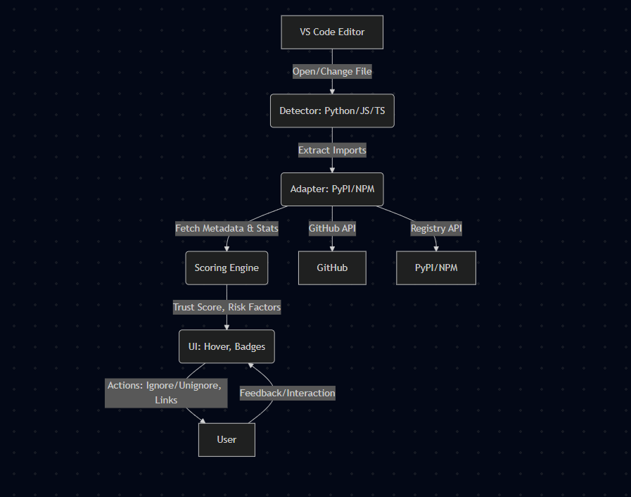

# 🛡️ PkgGuard: Package Security for VS Code

**PkgGuard** is a VS Code extension that protects developers from AI hallucinations and malicious package imports by analyzing package trustworthiness in real-time. It supports Python (PyPI) and JavaScript/TypeScript (npm) ecosystems with comprehensive terminal integration.

[](https://github.com/shafnir/PkgGuard/releases)
[](LICENSE)
[](https://code.visualstudio.com/)

## 🚀 Quick Start

### Installation
1. Open VS Code
2. Go to Extensions (Ctrl+Shift+X)
3. Search for "PkgGuard"
4. Install and reload VS Code

### Instant Security Analysis
Once installed, PkgGuard automatically analyzes your imports:
- **Python**: `import requests`, `from flask import Flask`
- **JavaScript/TypeScript**: `import axios from 'axios'`, `const express = require('express')`

## 🗺️ Architecture Overview


## ✨ Key Features

### 🔍 Real-Time Security Analysis
- **Trust Badges**: Inline indicators for every import (🟢 High, 🟡 Medium, 🔴 Low, ❓ Unknown)
- **Hover Details**: Rich information panels with trust scores, risk factors, and registry links
- **Smart Detection**: Supports complex imports like `from flask import Flask` and `import xml.etree.ElementTree`
- **Node.js Built-ins**: Full support for `node:` prefix imports (e.g., `import * as path from "node:path"`)
- **Deprecation Warnings**: Detects deprecated npm packages with replacement suggestions
- **Typosquatting Protection**: Detects packages with suspicious names similar to popular ones

### 🖥️ Smart Terminal Integration
**Access**: Terminal dropdown → "PkgGuard Smart Terminal" or Command Palette → "PkgGuard: Create Terminal"

**Security Modes**:
- `[interactive]` 🟢 - Ask for approval on risky packages
- `[monitor]` 🟡 - Show warnings but allow installation  
- `[block]` 🔴 - Automatically block risky packages
- `[disabled]` ⚪ - No security checks

**Terminal Features**:
- **Command History**: Navigate with ↑/↓ arrows (100-command storage)
- **Tab Completion**: Autocomplete for commands, files, and directories
- **Virtual Environment Support**: Full Python venv workflow with VS Code integration
- **Manifest Scanning**: Security analysis for `requirements.txt` and `package.json`

### 🐍 Python Virtual Environment Workflow
```bash
create-venv myproject    # Create new environment
activate-venv myproject  # Activate environment
pip install requests     # Install with security monitoring
deactivate-venv         # Deactivate environment
```

### 🔒 Privacy & Performance
- **Local Processing**: No telemetry, your code stays on your machine
- **Smart Caching**: Fast response times with intelligent caching
- **Optimized Performance**: Efficient processing that doesn't slow down your editor
- **Minimal Network Usage**: Only checks packages when needed

## 🧠 How It Works

1. **Import Detection**: Automatically detects package imports in Python, JavaScript, and TypeScript files
2. **Registry Analysis**: Analyzes packages from PyPI, npm, and GitHub for trustworthiness
3. **Trust Scoring**: Evaluates packages based on multiple security and reliability factors
4. **Real-Time Updates**: Shows trust indicators directly in your editor
5. **Terminal Protection**: Monitors package installations and warns about risky packages

## 📖 Usage Guide

### Editor Features
- **Hover** over any import to see trust score, risk factors, and direct links
- **Ignore/Unignore** packages via hover UI or Command Palette
- **Clear cache** with `PkgGuard: Clear Cache` command
- **Toggle extension** via status bar shield icon

### Terminal Commands
| Command | Description |
|---------|-------------|
| `create-venv [name]` | Create new virtual environment |
| `activate-venv [name/path]` | Activate virtual environment |
| `deactivate-venv` | Deactivate current environment |
| `list-venvs` | List available environments |
| `scan-manifest` | Analyze requirements.txt/package.json |
| `install-manifest` | Install dependencies with security filtering |
| `help` | Show all available commands |

### Configuration
Access settings via VS Code Settings (Ctrl+,) and search for "PkgGuard":
- `pkgGuard.enabled` - Enable/disable extension
- `pkgGuard.securityMode` - Set terminal security mode
- `pkgGuard.cacheTTL` - Cache duration (default: 48 hours)
- `pkgGuard.terminal.enabled` - Enable terminal monitoring

## 🎉 What's New in v0.7.3

### 🆕 Node.js Built-in Module Support
- Properly detects and scores imports with `node:` prefix
- Example: `import * as path from "node:path"` now scores 100 (built-in)
- All Node.js built-in modules are recognized and trusted

### ⚠️ Deprecated Package Detection
- Automatically detects deprecated npm packages
- Shows clear warnings with replacement suggestions
- -60 trust score penalty for deprecated packages
- Example: `vsce` shows deprecation warning and suggests `@vscode/vsce`

### 🖥️ Terminal Autocomplete Fix
- Tab completion now properly completes in-place
- No more unwanted new lines during autocomplete
- Professional terminal behavior matching standard shells

## 🎯 Trust Levels

PkgGuard evaluates packages and shows trust indicators:

- **🟢 High Trust**: Well-established, popular packages with good maintenance
- **🟡 Medium Trust**: Decent packages but may have some concerns
- **🔴 Low Trust**: Packages with significant risk factors or concerns
- **❓ Unknown**: Unable to evaluate (network issues, new packages)
- **⚪ Ignored**: Packages you've chosen to ignore

## 🔧 Development & Contributing

### Requirements
- VS Code 1.101.0+
- Node.js 20.0.0+

### Build Commands
```bash
npm run compile    # Build the extension
npm run watch      # Watch mode for development
npm run test       # Run tests
npm run lint       # Check code quality
npm run package    # Create extension package
```

## 🔒 Security & Privacy

> **Important**: PkgGuard helps identify suspicious packages but doesn't scan for known CVEs. It's designed to prevent AI hallucinations and typosquatting attacks—your smart first line of defense.

- **Local Processing**: No telemetry, all data stays on your machine
- **Secure Connections**: All external API calls use secure HTTPS connections
- **Privacy First**: We don't collect or store any of your code or personal information
- **Reliable**: Designed to handle network issues gracefully without disrupting your workflow

## 📝 License

MIT License - see [LICENSE](LICENSE) for details.

## 🤝 Contributing

We welcome contributions! Please see our [Contributing Guidelines](CONTRIBUTING.md) for details.

---

**Stay secure. Code confidently. Trust PkgGuard.** 
